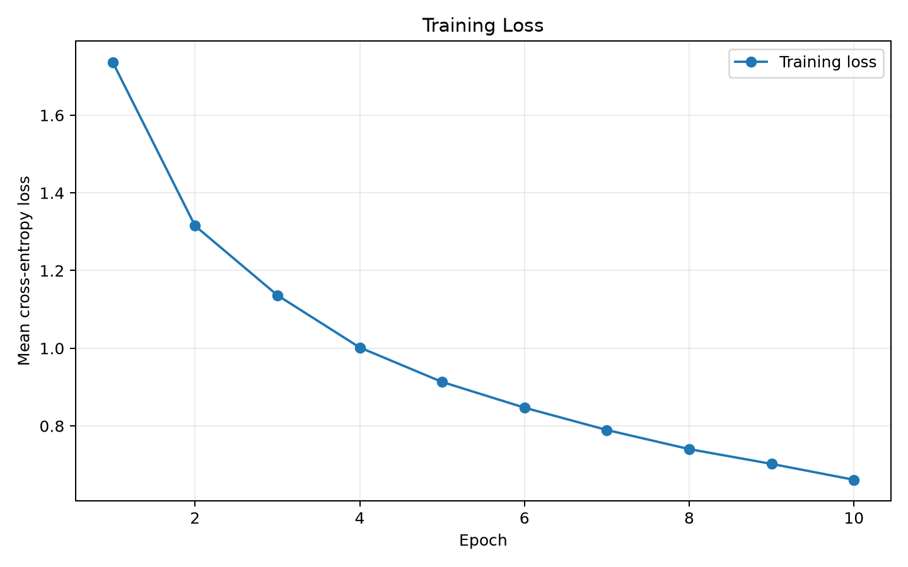
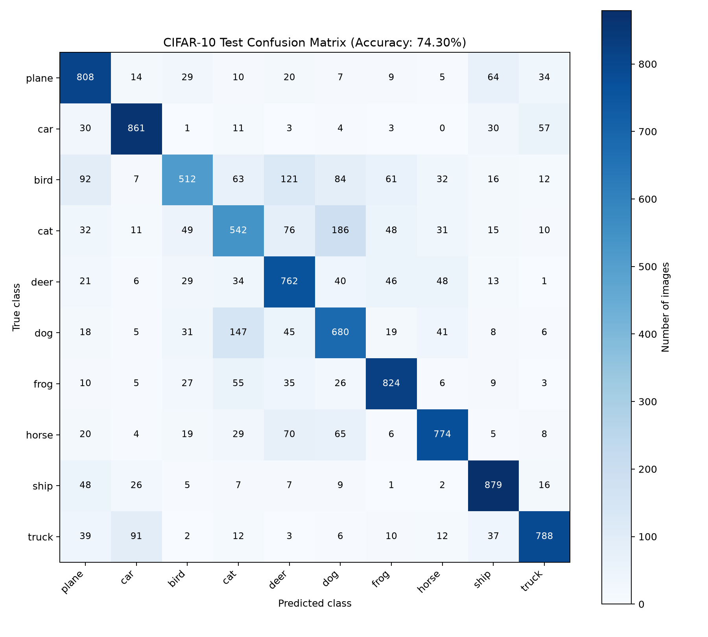

# CIFAR-10 CNN 实验记录

一个基于 PyTorch 的图像分类课程项目。从参考卷积网络出发，尝试增加训练轮数、随机水平翻转、调整卷积通道、平均池化和全连接层，并保留成功与失败的实验记录。

最终保存模型的测试准确率为 **74.30%**，训练集准确率为 **79.12%**，参数量为 **151,882**。结果来自本地单次实验，不代表多次运行的平均成绩。

## 模型结构

```text
RGB 32×32
→ Conv(3→32, 3×3, padding=1) → ReLU → MaxPool(2×2)
→ Conv(32→64, 3×3, padding=1) → ReLU → MaxPool(2×2)
→ AdaptiveAvgPool(4×4) → Flatten
→ Linear(1024→128) → ReLU → Linear(128→10)
```

保留4×4空间信息，并通过带ReLU的隐藏全连接层组合特征。曾尝试将特征图直接全局平均到1×1，但在当前两层卷积和训练设置下效果较差。

## 实验结果

| 方案 | 数据划分 | 指标 |
|---|---|---|
| 参考结构，3轮，加入结果记录后重新运行 | 50,000训练 / 10,000测试 | 测试55.45% |
| 参考结构，10轮 | 50,000训练 / 10,000测试 | 测试63.17% |
| 参考结构，翻转增强，10轮 | 45,000训练 / 5,000验证 | 最高验证66.20% |
| 32/64通道，全局平均池化，10轮 | 同上 | 最高验证52.94% |
| 32/64通道，4×4平均池化，两层全连接，10轮 | 同上 | 最高验证74.30%，最终测试74.30% |

不同划分的指标不能直接作为单因素比较。前期查看过参考模型的测试成绩，后续结构选择主要依据固定验证集。最终组合同时调整了池化和分类层，不能把提升全部归因于单一改动。

## 运行

本地实验环境：Windows、Python 3.14.6、PyTorch 2.11.0（CUDA 12.8构建）、torchvision 0.26.0、NVIDIA GeForce RTX 5060 Laptop GPU。脚本也支持CPU，耗时会不同。

```powershell
python -m venv .venv
.\.venv\Scripts\python -m pip install -r requirements.txt
.\.venv\Scripts\python original_code.py
```

请在项目根目录运行。首次训练会下载CIFAR-10到`data/`；也可以将完整的`cifar-10-python.tar.gz`预先放进`data/`。数据集不随仓库分发。GPU运行需要安装适配本机的PyTorch构建；上述依赖版本记录实验环境，不保证所有平台都有对应安装包。

训练设置为10轮、batch_size=8、SGD学习率0.001、momentum=0.9。随机种子为42；官方训练集固定分成45,000张训练和5,000张验证。训练时随机水平翻转，评估时不随机增强。固定种子有助于复现，但不保证跨设备逐位一致。

训练会覆盖根目录`model.pt`及训练日志；需要保留模型时先备份。每轮验证成绩提高时保存模型，训练结束加载最佳参数进行评估。

仅评估仓库中的已训练模型，不重新训练：

```powershell
python original_code.py --evaluate-only
```

该模式需要已经下载并解压的数据集及`training_history.csv`，生成测试结果、预测记录和图表到`final_results/`。

## 结果图





混淆矩阵纵轴是真实类别，横轴是预测类别，单位为图片数量。猫狗混淆较明显：186张猫被预测为狗，147张狗被预测为猫。

## 文件说明

- `original_code.py`：网络、训练、评估和绘图。
- `model.pt`：最佳模型参数。
- `training_history.csv`：最终实验每轮损失及验证准确率。
- `evaluation.txt`、`training_time.txt`：最终实验指标与训练耗时。128.43秒只统计训练循环，不含验证、测试、下载和保存。
- `final_results/`：官方测试集结果与报告图表。
- `experiments/`：历史方案代码和日志，不重复存储历史权重。

参考网络来自课程提供的示例；数据集通过torchvision的CIFAR10接口读取。项目在AI辅助讲解、编码与检查下逐步完成，训练结果来自实际运行。课程模板和含个人学籍信息的报告不包含在仓库中。
